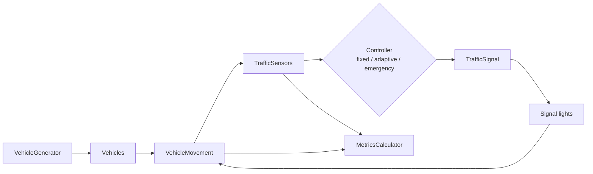
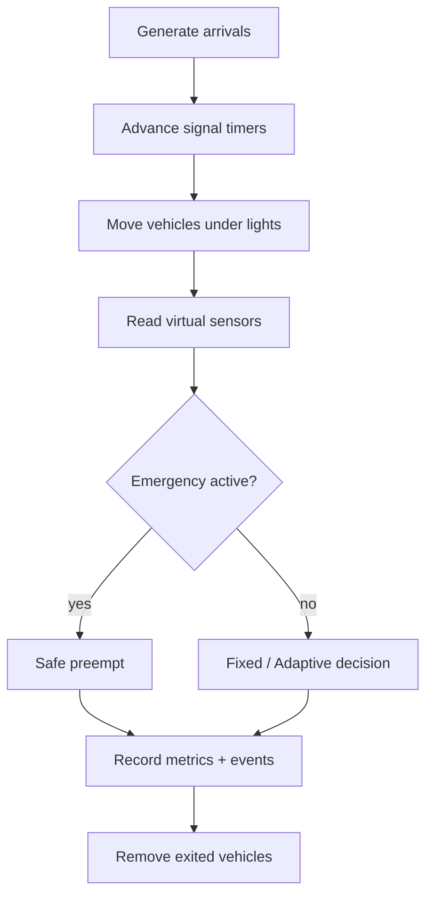
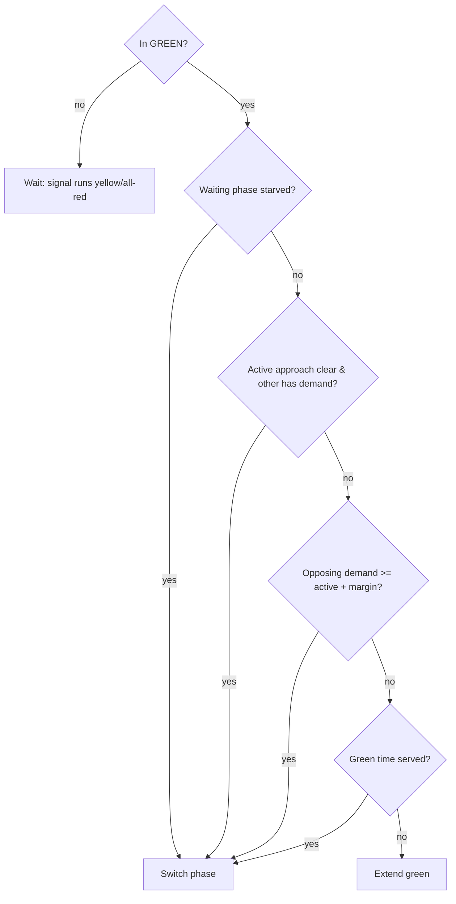

# Smart Traffic Light Control Simulation

An interactive React simulation of an intelligent traffic management system at a
four-lane highway intersection. It compares a traditional **fixed-time** signal
controller against an **adaptive, rule-based** controller that responds to
simulated sensor data, weather, and emergency vehicles, and reports measured
performance differences.

> Academic software engineering project. All timing values are configurable
> simulation assumptions, not validated real-world traffic-engineering standards.

## Project overview

Traffic signals that change on a fixed timer ignore actual demand, causing
avoidable delay when traffic is uneven. This project simulates a smart
controller that reads virtual sensors (queue length, waiting time, arrival rate)
and adjusts green durations accordingly, while always obeying signal-safety
rules. The adaptive controller is then benchmarked against a fixed-time baseline
on identical, reproducible traffic.

## Problem statement

Can a deterministic, rule-based adaptive controller measurably reduce average
waiting time and queue length versus a fixed-time controller, without ever
creating unsafe (conflicting) signal states, and while safely granting
emergency-vehicle priority and adapting to adverse weather?

## Objectives

- Model vehicle arrivals, movement, queues, and signal states at a 4-lane
  intersection (two inbound lanes per approach).
- Implement fixed-time and adaptive controllers that share one safe signal
  model (green → yellow → all-red → next green).
- Derive sensor readings from actual simulated vehicle state.
- Make weather affect both vehicle movement and signal timing.
- Provide emergency-vehicle priority without conflicting greens.
- Compare both controllers on identical, reproducible traffic (seeded RNG).

## Technology stack

- **React + JavaScript (JSX)** — UI
- **Vite** — tooling / dev server / build
- **Tailwind CSS** — styling
- **Recharts** — performance charts
- **Lucide React** — icons
- **HTML5 Canvas** — animated top-down intersection
- **Vitest + jsdom** — automated tests

No backend, database, or paid APIs. Runs fully locally.

## Getting started

### Prerequisites

- **Node.js 18 or newer** (developed on Node 24). Check with `node --version`.
- **npm 9 or newer** (ships with Node). Check with `npm --version`.
- A modern browser with HTML5 Canvas support (Chrome, Edge, Firefox, Safari).

No backend, database, environment variables, or paid APIs are required. The app
runs entirely in the browser.

### 1. Clone the repository

```bash
git clone git@github.com:akinbogundennis/smart-traffic-control.git
cd smart-traffic-control
```

> HTTPS alternative:
> `git clone https://github.com/akinbogundennis/smart-traffic-control.git`

### 2. Install dependencies

```bash
npm install
```

This installs React, Vite, Tailwind CSS, Recharts, Lucide React, and the Vitest
test tooling.

### 3. Run the development server

```bash
npm run dev
```

Vite prints a local URL (default **http://localhost:5173**). Open it in your
browser. The dev server supports hot-reload, so edits appear without a manual
refresh. Press `Ctrl + C` in the terminal to stop it.

### 4. Build for production

```bash
npm run build     # outputs an optimized bundle to dist/
npm run preview   # serve the built bundle locally to verify it
```

The `dist/` folder is a static site and can be hosted on any static host
(GitHub Pages, Netlify, Vercel, S3, etc.).

### 5. Run the tests

```bash
npm test          # run the Vitest suite once
npm run test:watch # re-run on file changes
```

### Available npm scripts

| Script | What it does |
|---|---|
| `npm run dev` | Start the Vite dev server with hot-reload |
| `npm run build` | Produce an optimized production build in `dist/` |
| `npm run preview` | Serve the production build locally for a final check |
| `npm test` | Run the automated test suite once (Vitest) |
| `npm run test:watch` | Run tests in watch mode |

### Using the dashboard

1. Open the app and land on the **Simulation** tab.
2. Press **Start** in the control panel (left) to run the simulation.
3. Adjust **mode** (Fixed-Time / Adaptive), **weather**, **traffic volume**,
   **per-direction demand**, and **speed** (1x / 2x / 5x) — every control
   affects the live simulation.
4. Click an **Emergency vehicle** direction to inject an ambulance and watch the
   safe priority handling.
5. Open **Analytics** or **Scenario Testing** to run both controllers against
   identical traffic and compare the measured results.
6. **System Architecture** and **About Project** document the design.

### Troubleshooting

- **Blank page**: hard-refresh the browser (`Ctrl + Shift + R`) to clear cached
  modules. A caught render error is shown on-screen with details rather than a
  blank page.
- **Port 5173 in use**: Vite will pick the next free port and print the URL;
  use whatever it prints.
- **`npm install` warnings about vulnerabilities**: these are in dev-only
  tooling dependencies and do not affect the running app. Avoid
  `npm audit fix --force`, which can introduce breaking changes.
- **Node too old**: if `npm run dev` fails on syntax, upgrade to Node 18+.

## Functional requirements (implemented)

- Start / pause / resume / reset, and 1x / 2x / 5x simulation speed.
- Fixed-time vs adaptive control toggle.
- Traffic volume presets (Low / Normal / Rush Hour / Heavy / Custom) and
  per-direction demand sliders.
- Weather presets (Clear / Heavy Rain / Fog) affecting movement and timing.
- Emergency vehicle injection from any approach with safe priority.
- Live sensor visualization toggle.
- Live metrics: generated, processed, avg wait, current/avg/max queue,
  throughput per hour, avg travel delay, phase, green time, emergencies.
- Live charts: waiting time, queue length, throughput over time, demand by
  direction.
- Controller comparison across five predefined scenarios with improvement %.
- Event log.

## Nonfunctional & safety requirements

- Conflicting directions never receive green simultaneously.
- Every green transitions through yellow and all-red before the next green.
- Same scenario + seed produces reproducible results.
- UI is a responsive, readable dark operations dashboard.

## System architecture

Modular design separating UI, simulation logic, control algorithms, and
analytics. UI components never contain simulation logic; they render snapshots
and dispatch operator actions.

```
src/
├── components/
│   ├── common/        Panel, StatCard
│   ├── intersection/  IntersectionCanvas + canvas draw helpers
│   ├── controls/      ControlPanel
│   ├── dashboard/     pages: Simulation, Analytics, Scenario, Architecture, About
│   └── analytics/     LiveCharts, ComparisonView
├── simulation/
│   ├── SimulationEngine.js   orchestrator (unidirectional data flow)
│   ├── SimulationClock.js    fixed-timestep clock
│   ├── VehicleGenerator.js   seeded arrivals
│   ├── VehicleMovement.js    car-following + signal-aware physics
│   ├── TrafficSensors.js     readings derived from vehicle state
│   └── TrafficSignal.js      safe signal state machine
├── controllers/
│   ├── FixedTimeController.js
│   ├── AdaptiveController.js
│   └── EmergencyPriorityController.js
├── scenarios/        scenarioDefinitions.js, ScenarioRunner.js
├── analytics/        MetricsCalculator.js, ComparisonEngine.js
├── hooks/            useSimulation.js
├── utils/            constants.js, rng.js, geometry.js
├── __tests__/        safety, adaptive, movement, engine tests
├── App.jsx
└── main.jsx
```

### Component responsibilities

| Module | Responsibility |
|---|---|
| SimulationEngine | Runs the step loop, wires all modules, produces snapshots |
| SimulationClock | Converts real frames into fixed simulation steps |
| VehicleGenerator | Spawns vehicles per demand using the seeded RNG |
| VehicleMovement | Moves vehicles: accelerate, follow, stop at red, cross, exit |
| TrafficSensors | Computes per-approach count/queue/arrival/wait/occupancy |
| TrafficSignal | Enforces green→yellow→all-red safety sequence |
| FixedTimeController | Constant-duration cycle, demand-independent |
| AdaptiveController | Green sizing from sensors + anti-starvation + hysteresis |
| EmergencyPriorityController | Safe preemption for emergency approaches |
| MetricsCalculator | Collects metrics from real simulated events |
| ComparisonEngine | Improvement % (lower-is-better aware) |

### Data flow (Mermaid)



### Simulation step workflow (Mermaid)



### Adaptive controller decision (Mermaid)



## Rule-based control algorithm

Green duration in adaptive mode:

```
greenTime = clamp(
  baseGreen + queueWeight * queueLength + waitWeight * averageWait,
  minGreen, maxGreen
)
```

Defaults: `baseGreen 12s`, `queueWeight 2.2`, `waitWeight 0.25`,
`minGreen 10s`, `maxGreen 60s`, `yellow 3s`, `allRed 2s`,
`maxWaitThreshold 90s`. Hysteresis (switch margin + minimum green) prevents
rapid flip-flopping; an anti-starvation guard forces a switch when a phase has
waited too long.

## Simulation assumptions

- Vehicles travel straight through and continue to the edge of the world after the light; no turning movements or lane changes.
- One isolated intersection; no network coordination.
- Weather effects are simplified rules (speed, acceleration, stopping distance,
  yellow/all-red length), not a safety-validated model.
- Arrivals follow a seeded per-step Bernoulli process approximating Poisson.

## Test scenarios

1. **Normal Traffic** — balanced, clear weather; baseline operation.
2. **Rush-Hour Congestion** — high arrivals, heavier N-S demand; adaptive should
   respond to growing queues.
3. **Low Traffic Volume** — few vehicles; evaluates unnecessary waiting.
4. **Adverse Weather** — heavy rain reduces speeds and lengthens clearance.
5. **Emergency Vehicle** — emergency injected during a conflicting phase; verify
   safe priority and restoration.

Each scenario runs both controllers on identical traffic and reports a measured
comparison.

## Performance evaluation methodology

Both controllers run headlessly against a scenario's fixed inputs and seed, so
traffic arrivals are identical. Improvement for lower-is-better metrics:

```
improvementPercent = ((fixedValue - adaptiveValue) / fixedValue) * 100
```

For throughput (higher is better) the sign is flipped so positive always means
"adaptive better". Zero baselines are reported as n/a. Results are computed from
actual simulated events and are not hardcoded; adaptive may perform worse in
some scenarios and that is reported as measured.

## Automated tests

`npm test` runs Vitest coverage of:

1. No conflicting greens.
2. Green → yellow → all-red → next green sequence.
3. Adaptive green responds to queue length.
4. Green stays within min/max limits.
5. Weather affects speed and clearance timing.
6. Emergency priority never bypasses safe transitions.
7. Vehicles stop at red.
8. Waiting time is calculated correctly.
9. Comparison runs use identical arrivals.
10. Reset restores the initial state.

## Limitations

- Canvas top-down rendering (not photoreal 3D).
- Single intersection, straight-through movements only.
- Simplified weather and arrival models.
```
